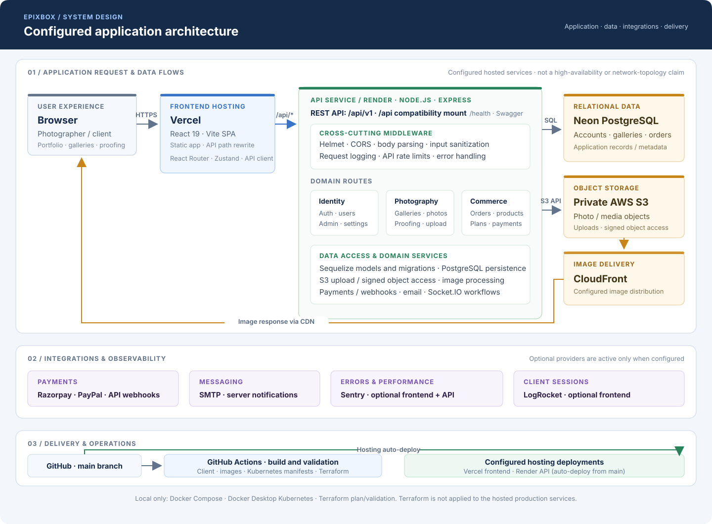
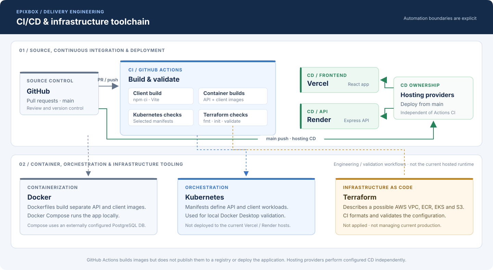

# EpixBox

> A full-stack photography platform for photographers to showcase portfolios,
> manage galleries, handle client proofing, and process orders.


[Live application](https://epixbox.vercel.app/) · [API documentation](https://epixbox.onrender.com/api/docs) · [Source code](https://github.com/Deepparmar07/Epixbox)

## Contents

- [Overview](#overview)
- [Features](#features)
- [Technology stack](#technology-stack)
- [Architecture](#architecture)
- [How EpixBox is built](#how-epixbox-is-built)
- [Further documentation](#further-documentation)
- [Repository structure](#repository-structure)
- [Prerequisites](#prerequisites)
- [Getting started](#getting-started)
- [Available scripts](#available-scripts)
- [API and payments](#api-and-payment-notes)
- [Docker Compose](#docker-compose)
- [Local Kubernetes](#local-kubernetes-with-docker-desktop)
- [Terraform foundation](#terraform-aws-foundation)
- [CI checks](#ci-checks)
- [Hosted deployment](#hosted-deployment)
- [Monitoring and configuration](#monitoring-and-configuration)
- [Validation](#validation)
- [License](#license)

## Overview

EpixBox is a monorepo containing a React/Vite client and a Node.js/Express
API. The application supports photographer portfolios, galleries, private
proofing workflows, photo downloads, orders, subscriptions, and administration.

The configured public application topology is:

```text
GitHub -> Vercel frontend -> Render API -> Neon PostgreSQL
                                      -> AWS S3 -> CloudFront for image delivery
```

Vercel hosts the frontend and proxies API requests to Render. The API uses
Neon PostgreSQL for application data and AWS S3 for media objects. A separately
configured CloudFront distribution delivers S3-hosted image assets; CloudFront
is not the frontend host.

The repository also contains Docker, Docker Compose, Docker Desktop Kubernetes,
Terraform, and GitHub Actions configuration. Docker Compose and Kubernetes are
for local development and validation. Terraform is a plan/validation foundation
for a possible AWS deployment; it is not connected to the current hosted
services or applied by CI.

## Features

- Portfolio and gallery management
- Public and private gallery access
- Client proofing, photo selections, comments, and approvals
- Image uploads, processing, downloads, and watermark support
- Orders, products, inventory, coupons, shipping, and analytics
- Subscription plans and account feature gates
- Razorpay and PayPal payment integrations, including Razorpay webhooks
- JWT authentication, role-based access, rate limiting, and validation
- Admin dashboard and Swagger API documentation
- Socket.IO real-time communication
- AWS S3 object storage with signed URLs and CloudFront image delivery
- Optional Sentry error/performance monitoring and LogRocket client monitoring

## Technology Stack

### Application

- React 19, Vite, React Router, Zustand, and Tailwind CSS
- Node.js 20, Express, Sequelize, and PostgreSQL
- Socket.IO for real-time communication
- Sharp for image processing
- AWS SDK for S3 storage
- JWT, bcrypt, Helmet, CORS, and express-rate-limit
- Nodemailer for email
- Razorpay and PayPal SDK/client integrations
- Swagger UI and Swagger JSDoc for API documentation

### DevOps and deployment

- Docker and Docker Compose
- Nginx for the client container
- Kubernetes manifests validated for a local Docker Desktop cluster
- GitHub Actions continuous integration for builds and infrastructure validation
- Terraform configuration for a future AWS VPC, ECR, S3, and EKS setup
- Vercel frontend hosting and Render API hosting
- Neon PostgreSQL, AWS S3, and CloudFront CDN for hosted image assets

### Monitoring

- Sentry SDKs for optional client and API error/performance monitoring
- LogRocket for optional client session monitoring
- Winston structured server logs

Sentry and LogRocket are initialized only when their corresponding DSN or
application ID is configured. See [Monitoring](#monitoring-and-configuration).

## Architecture



### CI/CD and infrastructure toolchain



**CI:** GitHub Actions builds the client and container images and validates
selected Kubernetes manifests and Terraform configuration on pushes to `main`
and pull requests targeting `main`. **CD:** configured Vercel and Render
integrations auto-deploy from `main`; the repository does not configure a
GitHub Actions deployment job. Docker Compose and Kubernetes are local
workflows. Terraform describes a possible AWS foundation and is validated by
CI, but has not been applied to the hosted production services.

## How EpixBox is built

EpixBox is organized as an npm-workspaces monorepo. The `client` and `server`
are separately deployable applications, developed and versioned together.

1. **Build the photographer and client experience.** The React 19 + Vite
   frontend provides gallery management, portfolios, proofing, shopping, and
   account/admin screens. React Router handles navigation, Zustand holds
   client state, and React Query is available for server-state workflows.
2. **Expose application workflows through an API.** A Node.js 20 + Express
   service groups authentication, gallery, photo, proofing, order, subscription,
   payment, and administration endpoints under `/api/v1`. Middleware handles
   authentication, validation, CORS, rate limits, request logging, and errors.
3. **Persist business data separately from media.** Sequelize maps application
   records to PostgreSQL; ordered migrations evolve the schema. Photo objects
   are stored in private AWS S3, with signed URLs used for object access and
   CloudFront configured for image delivery.
4. **Connect domain services.** Sharp and supporting services process images
   and metadata. Socket.IO supports real-time communication; Nodemailer sends
   transactional email. Razorpay and PayPal integrations support configured
   payment flows and webhooks.
5. **Operate and observe the application.** Vercel hosts the frontend and
   proxies API paths to Render, where the Express service runs. Sentry can
   capture frontend and API errors/traces, LogRocket can provide client-session
   monitoring, and Winston writes structured server logs when configured.
6. **Validate changes before release.** GitHub Actions builds the client and
   container images and validates Kubernetes manifests and Terraform
   formatting/configuration. Local Docker Compose and Kubernetes workflows
   make the stack reproducible for development; they are not the production
   hosting platform.

These are the codebase’s architecture and configured integrations. Optional
services (monitoring, payment credentials, email delivery) are active only
when configured in their respective environments.

## Further documentation

- [Architecture and request flow](./docs/ARCHITECTURE.md)
- [Feature guide](./docs/FEATURES.md)
- [Environment setup](./docs/ENVIRONMENT_SETUP.md)
- [Project overview](./docs/PROJECT_OVERVIEW.md)
- [Infrastructure diagram](./docs/infrastructure-diagram.md)
- [Backup and recovery planning](./docs/backup-recovery.md)
- [Recorded load-test results and limitations](./docs/load-test-results.md)

## Repository Structure

```text
.
├── .github/workflows/       # GitHub Actions build and validation checks
├── client/                  # React/Vite frontend
│   ├── src/
│   └── scripts/
├── server/                  # Express API
│   ├── config/
│   ├── database/
│   ├── middleware/
│   ├── models/
│   ├── routes/
│   ├── scripts/
│   └── services/
├── docker/                  # Nginx configuration
├── docs/                    # Architecture, feature, setup, and operations guides
├── k8s/                     # Local Kubernetes manifests
├── terraform/               # Plan-only AWS foundation
├── Dockerfile.client        # Client build and Nginx runtime image
├── Dockerfile.server        # API runtime image
├── docker-compose.yml       # Local two-container deployment
├── render.yaml              # Render API service configuration
├── vercel.json              # Vercel SPA and API proxy configuration
├── start-all.ps1            # Windows development launcher
└── package.json             # npm workspace configuration
```

## Prerequisites

For normal development:

- Node.js 20 or newer
- npm
- PostgreSQL-compatible database, or a Neon `DATABASE_URL`

For the local container and Kubernetes workflows:

- Docker Desktop
- Docker Desktop Kubernetes enabled with the `docker-desktop` context
- `kubectl`

For Terraform validation only:

- Terraform CLI
- AWS credentials are **not** required for `init -backend=false` or `validate`

## Getting Started

Install dependencies from the repository root:

```bash
npm install
```

Configure the server environment. Use `server/.env` locally and never commit
real credentials. The server requires database connection settings and
`JWT_ACCESS_SECRET` / `JWT_REFRESH_SECRET`; for example:

```env
NODE_ENV=development
PORT=4000
DB_HOST=localhost
DB_PORT=5432
DB_NAME=photoapp_dev
DB_USER=postgres
DB_PASSWORD=your-local-password
DB_SSL=false
JWT_ACCESS_SECRET=generate-a-unique-local-secret
JWT_REFRESH_SECRET=generate-a-different-local-secret
CLIENT_URL=http://localhost:5173
FRONTEND_URL=http://localhost:5173
```

Alternatively, set `DATABASE_URL` instead of the individual `DB_*` values.
Copy the relevant optional variables from [`.env.example`](./.env.example)
into `server/.env` for integrations you need, such as S3, SMTP, payment
providers, Google sign-in, or Sentry. Never commit real credentials.

For the Vite client, create `client/.env.local` with:

```env
VITE_API_BASE_URL=http://localhost:4000/api/v1
```

Optional client integrations use `VITE_` variables from `.env.example`.
Vite embeds these values into the built client, so they must not contain
private credentials.

Run migrations only against the intended development database:

```bash
cd server
npm run db:migrate
cd ..
```

Start the frontend and API together:

```bash
npm run dev
```

- Frontend: `http://localhost:5173`
- API: `http://localhost:4000`
- API health check: `http://localhost:4000/health`

On Windows, `npm run oneclick` uses [start-all.ps1](./start-all.ps1) to start
the development processes and optionally open the checkout flow.

## Available Scripts

### Root

| Command | Purpose |
| --- | --- |
| `npm run dev` | Start the client and API in development |
| `npm run build` | Build the client |
| `npm run start` | Start the API |
| `npm run install:all` | Install root and workspace dependencies |
| `npm run oneclick` | Start the Windows development flow |

### Client

```bash
npm run dev --workspace=client
npm run build --workspace=client
npm run preview --workspace=client
```

### Server

```bash
npm run dev --workspace=server
npm run start --workspace=server
npm run db:migrate --workspace=server
npm run db:migrate:undo --workspace=server
npm run load:test --workspace=server
npm run test:razorpay-webhook --workspace=server
```

## API and Payment Notes

The API is mounted under `/api/v1`. Swagger documentation is available at
`/api/docs` or `/api/v1/docs` when the API is running, and at the
[hosted API documentation URL](https://epixbox.onrender.com/api/docs).

Implemented API areas include authentication, galleries, photos, proofing,
portfolio, uploads, orders, products, inventory, shipping, analytics,
subscriptions, payment methods, refunds, checkout, and administration.

Configure payment credentials only for providers and flows you have enabled.
Razorpay checkout and subscriptions use:

```env
RAZORPAY_KEY_ID=rzp_test_...
RAZORPAY_KEY_SECRET=replace-me
RAZORPAY_WEBHOOK_SECRET=replace-me
```

PayPal credentials are `PAYPAL_CLIENT_ID` and `PAYPAL_CLIENT_SECRET`; set
`PAYPAL_MODE=sandbox` for sandbox use or `PAYPAL_MODE=live` for live API
requests. Keep payment secrets on the server only.

The server includes a signed Razorpay webhook test helper:

```bash
cd server
npm run test:razorpay-webhook
```

## Docker Compose

The Compose setup runs the client behind Nginx and the API as a separate
container. Neon remains the external PostgreSQL provider; Compose does not
create a local database.

Ensure the required API values are available in `server/.env`, then run:

```bash
docker compose up --build
```

Open `http://localhost:8080`. Nginx serves the SPA and proxies `/api` and
Socket.IO traffic to the API container. To stop the stack:

```bash
docker compose down
```

The Compose setup is intended for local learning and validation. It does not
replace the hosted Vercel and Render deployment.

## Local Kubernetes with Docker Desktop

The `k8s/` directory contains manifests for running the API and client images
on Docker Desktop Kubernetes. This is a single-node local learning environment,
not the public production cluster.

Enable Kubernetes in Docker Desktop, select the kubeadm provisioning method,
and verify the context:

```powershell
kubectl config use-context docker-desktop
kubectl get nodes
```

Build the images into Docker Desktop's local image store:

```powershell
docker build -f Dockerfile.server -t epic-api:latest .
docker build -f Dockerfile.client -t epic-client:latest .
```

Create the ignored local Secret from the safe template, replace its placeholder
values, and apply the manifests:

```powershell
Copy-Item k8s/secret.example.yaml.template k8s/secret.yaml
# Edit k8s/secret.yaml; do not commit it.
kubectl apply -f k8s/
```

Check the resources and rollouts:

```powershell
kubectl get pods -n epixbox
kubectl get services -n epixbox
kubectl rollout status deployment/epixbox-api -n epixbox
kubectl rollout status deployment/epixbox-client -n epixbox
```

The client is exposed through a local NodePort:

```powershell
kubectl get service client -n epixbox
# Open http://localhost:<NodePort>, for example http://localhost:31161
```

The API uses `/health` probes and the client uses `/healthz`. ConfigMaps hold
non-secret settings; the Secret holds database and JWT values. The local
configuration uses `AUTO_MIGRATE=false` and
`ALLOW_PENDING_MIGRATIONS=true`. This prevents deferred schema changes from
being applied automatically to the existing Neon database.

The current API manifest uses host networking as a local connectivity
workaround. Review and redesign that setting before using the manifest in a
cloud Kubernetes cluster.

Minikube was previously used for local testing but is no longer the active
local cluster. Use the Docker Desktop `docker-desktop` context.

## Terraform AWS Foundation

The `terraform/` directory is a plan-only AWS foundation for future learning
and deployment. It defines:

- VPC and public/private subnets
- NAT gateway configuration
- ECR repositories
- Private encrypted and versioned S3 storage
- EKS cluster and managed node group

The existing S3-to-CloudFront distribution was configured separately in AWS and
is not currently created by this Terraform configuration. The Terraform
foundation is not connected to the existing Vercel, Render, Neon, or
CloudFront resources. No AWS resources are created by CI. Validate it locally
with:

```powershell
terraform -chdir=terraform init -backend=false
terraform -chdir=terraform validate
terraform -chdir=terraform plan
```

Do not run `terraform apply` without reviewing AWS costs, IAM permissions,
networking, and the production architecture. EKS, NAT gateways, load
balancers, and worker nodes can create charges.

## CI checks

GitHub Actions runs on pushes and pull requests targeting `main`. The workflow
currently:

1. Installs dependencies with `npm ci`
2. Builds the React client
3. Builds the API Docker image
4. Builds the client Docker image
5. Validates Kubernetes manifests with Kubeconform
6. Checks Terraform formatting
7. Initializes Terraform without a backend
8. Validates Terraform configuration

## Hosted Deployment

### Vercel

Vercel hosts the frontend. [vercel.json](./vercel.json) provides SPA fallback
behavior and proxies `/api/:path*` requests to the Render API.

### Render

Render hosts the Node.js API using [render.yaml](./render.yaml). Production
startup uses:

```env
AUTO_MIGRATE=false
ALLOW_PENDING_MIGRATIONS=true
```

This is intentional because pending migrations include changes that require
review before they are applied to the existing production database. Do not
enable automatic migrations in production without a backup and a controlled
migration plan.

### Data safety

The hosted database is Neon PostgreSQL and file storage uses AWS S3. CloudFront
delivers the S3-hosted image assets through a CDN. The Docker, Kubernetes, and
Terraform workflows must not be used to replace or reset the existing hosted
data. Never run destructive database commands such as `DROP`, `TRUNCATE`, or
Sequelize `sync({ force: true })` against production.

## Monitoring and configuration

Monitoring integrations are optional and stay disabled until their project
settings are provided:

| Integration | Environment variable | Purpose |
| --- | --- | --- |
| Sentry API | `SENTRY_DSN` | Captures API exceptions and performance traces |
| Sentry client | `VITE_SENTRY_DSN` | Captures client errors and performance traces |
| LogRocket | `VITE_LOGROCKET_APP_ID` | Enables client session monitoring |

`SENTRY_TRACES_SAMPLE_RATE` and `VITE_SENTRY_TRACES_SAMPLE_RATE` control
performance trace sampling. Configure client `VITE_*` values in the frontend
hosting environment; they are embedded in the client build and must not contain
private credentials. Configure API credentials and server-side `SENTRY_DSN` in
Render's server environment. Never commit database passwords, JWT secrets,
AWS credentials, or payment secrets.

See the [environment example](./.env.example) for configuration templates.
Some settings are optional or provider-specific; configure only the
integrations enabled for the target environment.

## Validation

Useful local checks include:

```bash
npm run build
git diff --check
```

For a server load test:

```bash
cd server
npm run load:test
```

## Contributing

1. Create a feature branch.
2. Make a focused change.
3. Run the relevant build, validation, or test commands.
4. Push the branch and open a pull request.

## License

Proprietary — All rights reserved. This repository is not open source.

---

**Last Updated:** October 24, 2026
