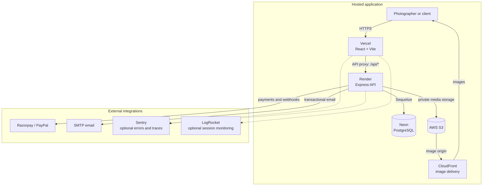

# EpixBox Architecture

EpixBox is a JavaScript/TypeScript monorepo with a React/Vite web client and a
Node.js/Express API. PostgreSQL stores application records; private AWS S3
stores media objects.

## Deployed topology

Vercel serves the client and rewrites `/api/:path*` to the Render API, as
configured in [`vercel.json`](../vercel.json). Render configuration is in
[`render.yaml`](../render.yaml). The Neon database, S3 bucket, and CloudFront
distribution are configured independently of the repository's Terraform
foundation.

## Request and data flow

1. The client sends API requests to `/api/v1`; local development can set
   `VITE_API_BASE_URL` to `http://localhost:4000/api/v1`.
2. Express applies the configured security, CORS, parsing, logging, rate-limit,
   authentication, and error-handling middleware before route handlers.
3. Sequelize reads and writes application data in PostgreSQL. Schema changes
   are tracked in `server/database/migrations/`.
4. Photo upload and download routes use the S3 service and short-lived signed
   object URLs. S3 stores media, while PostgreSQL stores application records
   and object metadata. CloudFront is configured for image delivery.
5. External services are integrated for payments, email, monitoring, and
   real-time communication when configured.

## Application layers

### Client

`client/src/` contains route pages, reusable components, API clients, hooks,
and state stores. React Router provides navigation; Zustand holds client-side
state, and React Query is included for server-state workflows. Vite builds the
static client for Vercel or the local Nginx container.

### API

`server/` contains Express routes, middleware, Sequelize models, migrations,
and service modules. The API is mounted at `/api/v1`; `/api` remains available
as a compatibility mount. Swagger UI is exposed at `/api/docs` and
`/api/v1/docs`.

### Persistence and media

- PostgreSQL is accessed through Sequelize; the app accepts `DATABASE_URL` or
  local `DB_*` connection settings.
- AWS SDK and `multer-s3` are used for S3 media operations.
- Sharp, EXIF utilities, and watermark services support image processing.
- S3-to-CloudFront delivery is configured separately; Terraform does not
  currently provision or manage that production distribution.

## Security and operations

- JWT access and refresh tokens authenticate API requests.
- Passwords are hashed with bcryptjs.
- The API uses Helmet, origin-based CORS configuration, rate limiting,
  express-validator, and request/error logging.
- Admin-only operations are protected by server-side role checks.
- Sentry is conditional on `SENTRY_DSN` / `VITE_SENTRY_DSN`; LogRocket is
  conditional on `VITE_LOGROCKET_APP_ID`.
- Winston writes structured server logs.

These describe implemented controls, not an independent security audit.
Optional integrations are only active when configured.

## Local and CI infrastructure

GitHub Actions builds the client and both container images, validates selected
Kubernetes manifests, and checks Terraform formatting/configuration. It does
not deploy the production resources.

Docker Compose runs a local Nginx client and API container but does not start a
database container; configure a local PostgreSQL instance or a development
database. Kubernetes manifests target a local Docker Desktop cluster.
Terraform is a plan/validation foundation for a possible AWS VPC, ECR, S3, and
EKS deployment; it is not connected to the current Vercel, Render, Neon, or
CloudFront resources. Review cost and security implications before any apply.

## Related documents

- [Feature guide](./FEATURES.md)
- [Local environment setup](./ENVIRONMENT_SETUP.md)
- [Infrastructure diagram](./infrastructure-diagram.md)
- [Backup and recovery planning](./backup-recovery.md)
- [Recorded load-test results](./load-test-results.md)
