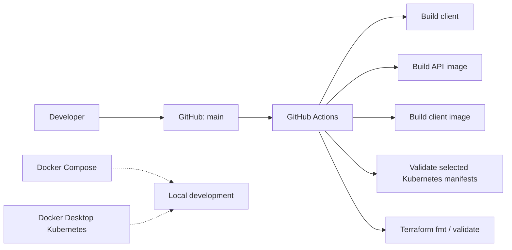

# EpixBox Infrastructure

## Configured hosted application

```mermaid
flowchart TB
  Dev["Developer"] -->|"push changes"| GitHub["GitHub repository"]
  GitHub -->|"deploy frontend"| Vercel
  GitHub -->|"auto-deploy API"| Render
  GitHub -->|"push / pull request checks"| Actions["GitHub Actions"]

  subgraph Checks["CI checks"]
    Actions --> ClientBuild["Build client"]
    Actions --> ImageBuild["Build API and client images"]
    Actions --> KubeCheck["Validate Kubernetes manifests"]
    Actions --> TerraformCheck["Format and validate Terraform"]
  end

  subgraph Hosted["Hosted application"]
    Browser["Photographer or client browser"]

    subgraph Frontend["Frontend hosting"]
      Vercel["Vercel<br/>React + Vite"]
    end

    subgraph APIService["Backend API"]
      Render["Render<br/>Node.js + Express"]
      API["REST API<br/>/api/v1"]
      Render --- API
    end

    subgraph Storage["Database and media"]
      Neon[("Neon PostgreSQL")]
      S3[("AWS S3")]
      CF["CloudFront CDN"]
    end

    subgraph Services["External integrations"]
      Pay["Razorpay / PayPal"]
      Email["SMTP email"]
      Sentry["Sentry (optional)"]
      LogRocket["LogRocket (optional)"]
    end

    Browser -->|"HTTPS"| Vercel
    Vercel -->|"API proxy"| Render
    Browser -->|"API requests (direct or proxy)"| API
    API -->|"Sequelize"| Neon
    API -->|"media operations"| S3
    S3 -->|"image delivery"| CF
    CF --> Browser
    API -->|"checkout / webhooks"| Pay
    API --> Email
    Vercel -.-> Sentry
    Render -.-> Sentry
    Vercel -.-> LogRocket
  end

  subgraph Local["Local development (not production hosting)"]
    Compose["Docker Compose"]
    DockerDesktop["Docker Desktop Kubernetes"]
    Terraform["Terraform foundation<br/>plan / validation"]
  end
```

CloudFront is used for image delivery, not frontend hosting. The distribution,
S3 bucket, and hosted database are configured independently of the checked-in
Terraform foundation.

## Build and validation

GitHub Actions performs builds and validation; it does not apply Terraform or
deploy the local Kubernetes setup. Vercel and Render have separate hosting
integrations for the hosted frontend and API.

## API details

- Versioned API prefix: `/api/v1`
- Compatibility API prefix: `/api`
- Swagger UI: `/api/docs` and `/api/v1/docs`
- Health check: `/health`
- Vercel proxies `/api/:path*` to the configured Render API.
