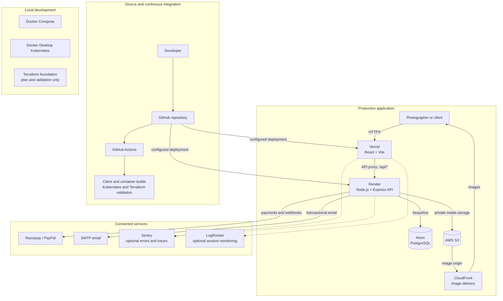
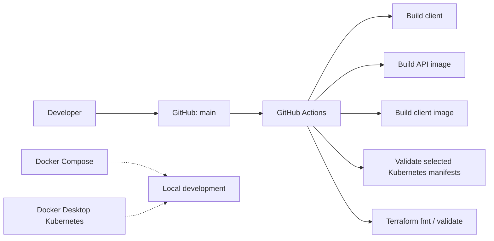

# EpixBox Infrastructure

## Configured hosted application

Solid arrows show application traffic and configured integrations; dotted
arrows indicate optional monitoring. GitHub Actions runs builds and
configuration checks, while Vercel and Render handle their configured
deployments. Docker Compose and Kubernetes are local workflows. Terraform is a
validation foundation, not the source of production resources.

## Build and validation

GitHub Actions performs builds and validation; it does not apply Terraform or
deploy the local Kubernetes setup. Vercel and Render have separate hosting
integrations for the hosted frontend and API.

## API details

- Versioned API prefix: `/api/v1`
- Compatibility API prefix: `/api`
- Swagger UI: `/api/docs` and `/api/v1/docs`
- Health check: `/health`
- Vercel proxies `/api/:path*` to the configured Render API.
